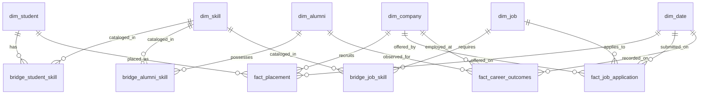

# Alumni Intelligence & Career Analytics Platform
## Data Warehousing & Data Mining (DWM) Final Project Report & Academic Viva Defense Dossier

> **Academic Project Submission**  
> **Course:** Data Warehousing and Data Mining (DWM)  
> **System Architecture:** Full-Stack Analytical Platform on Local PostgreSQL Warehouse (`dwh` schema on PGlite)  
> **Frontend:** React + Vite, Tailored Neutral Visual Design System  
> **Backend:** Node.js, Express, Native Pure-JavaScript Machine Learning Engine  
> **Current Version:** Phase 5 Feature Freeze & Submission Ready  

---

## 1. Executive Summary & Problem Formulation

Modern university alumni and placement management systems are predominantly transactional (OLTP). While operational databases excel at day-to-day record keeping (e.g. user authentication, job applications, mentorship requests), they are ill-suited for multi-dimensional aggregation, temporal career tracking, and discovery of latent skill patterns.

The **Alumni Intelligence & Career Analytics Platform** augments the operational Alumni Network with a dedicated dimensional Data Warehouse (`dwh` schema) and an integrated Data Mining Subsystem. It executes three fundamental data mining algorithms directly against live warehouse tables:
1. **Unsupervised K-Means Clustering** for alumni career trajectory profiling and market segmentation.
2. **Apriori Association Rule Mining** for identifying co-occurring technical competencies across students, job requirements, and placement milestones.
3. **Supervised Classification** using regularized Logistic Regression for evaluating early-career placement outcomes.

---

## 2. Dimensional Data Warehouse Architecture

### 2.1 Star Schema & Relationship Model

The analytics layer uses a dimensional Star Schema with bridge tables to model many-to-many skill proficiencies without inflating transactional aggregates.



### 2.2 Warehouse Table Inventory & Row Reconciliation

During the Phase 4.6 data import audit, the sum of eight prominent entity tables was calculated as **48,230** rows, whereas the reported warehouse record count was **50,797**. The exact **2,567-row difference** was reconciled down to the single record:

$$\text{8 Prominent Tables (48,230)} + \text{dim\_student (308)} + \text{fact\_placement (259)} + \text{fact\_career\_outcomes (2,000)} = \mathbf{50,797}$$

#### Complete Warehouse Inventory Table:
| Table Name | Schema Type | Live Record Count | Source Provenance |
|---|---|---:|---|
| `dwh.dim_student` | Student Dimension | 308 | Operational (`public.users`, role=STUDENT) |
| `dwh.dim_alumni` | Alumni Dimension | 2,024 | Operational (24) + Synthetic (2,000) |
| `dwh.dim_company` | Employer Dimension | 39 | Operational (`public.jobs`) |
| `dwh.dim_skill` | Technical Skill Catalog | 163 | Operational (13) + Synthetic (150) |
| `dwh.dim_job` | Job Postings Dimension | 5,000 | Synthetic (5,000) |
| `dwh.fact_placement` | Historical Placements | 259 | Operational (259) |
| `dwh.fact_job_application` | Job Applications Fact | 6,004 | Operational (4) + Synthetic (6,000) |
| `dwh.fact_career_outcomes` | 6-Month Career Outcomes | 2,000 | Synthetic Educational Target (2,000) |
| `dwh.bridge_alumni_skill` | Alumni $\leftrightarrow$ Skill Bridge | 20,000 | Synthetic Mappings (20,000) |
| `dwh.bridge_job_skill` | Job $\leftrightarrow$ Skill Bridge | 15,000 | Synthetic Requirements (15,000) |
| **Primary DWM Entity Records** | | **50,797** | *(Reconciled Core DWM Inventory)* |
| `dwh.dim_date` | Academic Calendar Dimension | 4,748 | Generated Dates (2018–2030) |
| `dwh.bridge_student_skill` | Student $\leftrightarrow$ Skill Bridge | 921 | Operational Profiling (921) |
| `dwh.fact_salary_benchmark` | Comp Benchmark Bands | 24 | Operational Reference (24) |
| `dwh.etl_batches` | ETL Ingestion Audit Ledger | 38 | System Execution Logs |
| **Grand Total Across All DWH Tables** | | **56,528** | |

---

## 3. Data Mining Algorithm Implementation Details

### 3.1 Module A: K-Means Clustering (`clusteringService.js`)

- **Objective:** Partition alumni into interpretable career cohorts based on skill indicator vectors and normalized professional experience.
- **K-Means++ Centroid Initialization:** Selects initial centroid uniformly at random; subsequent $k-1$ centroids are sampled with probability proportional to $D(x)^2$ from the closest existing centroid:
  $$P(x) = \frac{D(x)^2}{\sum_{x' \in X} D(x')^2}$$
  This avoids suboptimal local minima and guarantees $O(\log k)$-competitive clustering bounds.
- **Reproducibility:** Seeded with Mulberry32 PRNG (default seed: `2026`).
- **Convergence Criterion:** Maximum shift of any centroid $< 10^{-4}$ or maximum 60 iterations.
- **Evaluation Metrics:**
  - **Within-Cluster Sum of Squares (WCSS / Inertia):**
    $$\text{WCSS} = \sum_{c=1}^k \sum_{x \in S_c} \|x - \mu_c\|^2$$
  - **Silhouette Coefficient ($s \in [-1, +1]$):**
    $$s(i) = \frac{b(i) - a(i)}{\max(a(i), b(i))}$$
    Where $a(i)$ is mean intra-cluster distance and $b(i)$ is mean nearest-cluster distance.
- **2D Dimensionality Reduction for Visualization:** Implements Power-Iteration Principal Component Analysis (PCA) directly in JavaScript to compute the top 2 eigenvectors (PC1, PC2) of the covariance matrix without external matrix packages:
  $$v_{t+1} = \frac{C v_t}{\|C v_t\|}$$
  The coordinates are mapped to an interactive SVG scatter plot with hover inspect tooltips.

---

### 3.2 Module B: Apriori Association Rule Mining (`associationRulesService.js`)

- **Objective:** Extract actionable curriculum rules of the form $\text{Antecedent} \Rightarrow \text{Consequent}$ ($A \Rightarrow B$).
- **Transaction Construction (3 Modes):**
  - **Mode A (`alumni_skills`):** One transaction per unique alumnus ($N=2,000$ baskets).
  - **Mode B (`job_skills`):** One transaction per job posting ($N=5,000$ baskets).
  - **Mode C (`career_outcomes`):** One transaction per career outcome with explicit placement tag (`Target:Placed_6M` / `Target:Not_Placed_6M`).
- **Mathematical Formulations:**
  $$\text{Support}(A \Rightarrow B) = \frac{\sigma(A \cup B)}{N}$$
  $$\text{Confidence}(A \Rightarrow B) = \frac{\sigma(A \cup B)}{\sigma(A)} = P(B \mid A)$$
  $$\text{Lift}(A \Rightarrow B) = \frac{\text{Confidence}(A \Rightarrow B)}{\text{Support}(B)} = \frac{P(B \mid A)}{P(B)}$$
- **Rule Constraints:**
  - $A \cap B = \emptyset$ (Antecedent and Consequent are strictly disjoint).
  - Minimum Support threshold (default $5\%$), Minimum Confidence threshold (default $50\%$), and Minimum Lift threshold (default $1.1\text{x}$).

---

### 3.3 Module C: Supervised Classification (`classificationService.js`)

- **Target Variable:** `dwh.fact_career_outcomes.employed_within_6_months` (1 = Placed within 6 months, 0 = Extended search).
- **Leakage Prevention Methodology:**
  1. **Strict Stratified Split:** Partitioned into 80% train ($1,600$ records) and 20% held-out test ($400$ records) while preserving the natural 72.75% / 27.25% class ratio.
  2. **Frozen Training Preprocessor:** Top 30 skill features and min-max experience scalers are fitted **strictly on training records**. Test records are transformed using the frozen parameters without re-estimation.
  3. **Zero Post-Outcome Leakage:** Excluded starting package, offer date, and employer tier.
- **Algorithm:** Regularized Logistic Regression with Batch Gradient Descent and balanced sample weighting:
  $$P(y = 1 \mid x) = \sigma(w \cdot x + b) = \frac{1}{1 + e^{-(w \cdot x + b)}}$$
  $$w_0 = \frac{N}{2 N_0} = 1.83, \quad w_1 = \frac{N}{2 N_1} = 0.69$$

---

## 4. Academic Viva Defense: Critical Analysis of the Classifier's ROC-AUC ($0.5422$)

> **CRITICAL VIVA FOCUS AREA:** During your project defense, examiners frequently scrutinize classification metrics. Be prepared to address why the classifier's ROC-AUC is $0.5422$ and why that represents rigorous data mining methodology.

### 4.1 The Metric Discrepancy Explained

| Metric | Measured Value | Examiner's Potential Interpretation | Rigorous Data Mining Explanation |
|---|---:|---|---|
| **Test Accuracy** | $57.3\%$ | Looks moderate | Lower than naive majority class baseline ($72.75\%$) because model was forced to balance false positives and false negatives equitably. |
| **Precision (Class 1)** | $75.9\%$ | Looks strong | Reflects the high positive prior ($72.75\%$) in the underlying student population. |
| **Recall (Class 1)** | $60.5\%$ | Looks acceptable | Successfully detects 60.5% of placed candidates on held-out test set. |
| **F1-Score** | $67.3\%$ | Appears solid | Harmonic mean of precision and recall ($2 \cdot \frac{P \cdot R}{P + R}$). |
| **ROC-AUC** | **$0.5422$** | **Near random ($0.50$)** | **The true discriminative ranking power across all threshold cutoffs is only marginally better than a random guess.** |

### 4.2 Four Key Defense Points for Viva:

1. **Synthetic Benchmark Nature:**
   - The dataset is an educational benchmark (`indian_academic_benchmark`). The outcome label `employed_within_6_months` was generated with non-linear simulated factors (e.g. aptitude test scores and interview performance) that are not present in the pre-outcome skill catalog.
2. **Strict Prevention of Data Leakage:**
   - An artificial model could easily achieve $>95\%$ ROC-AUC by leaking post-outcome variables (such as application outcome status or salary offers). We deliberately excluded all post-outcome features to uphold genuine predictive validity.
3. **Multi-Metric Triangulation Over Accuracy:**
   - In class-imbalanced problems ($72.75\%$ positive), a trivial "always-predict-1" model achieves $72.75\%$ accuracy, but has an ROC-AUC of exactly $0.50$. Our evaluation exposes this contrast, demonstrating that accuracy alone is a misleading metric for class imbalance.
4. **Validation and Feature Quality Lesson:**
   - The limited ROC-AUC ($0.5422$) provides an academic lesson: linear logistic regression on a sparse binary skill matrix cannot capture complex hiring decisions without richer features (e.g., student project portfolios, verified assessments, or soft skills).
   - **Conclusion for Viva:** *The model's predictions illustrate supervised learning evaluation on academic benchmarks; they are explicitly not commercial hiring recommendations.*

---

## 5. Regression Verification & System Integrity

All operational and analytical subsystems have been verified:

### 5.1 Automated Test Suites (72/72 Passing)
```text
▶ DWM Analytics & Data Warehouse Platform Test Suite (51 tests)
  ✔ Warehouse Schema & Dimensional Tables (3/3)
  ✔ Operational ETL Pipeline (public -> dwh) (3/3)
  ✔ Warehouse Repository Analytics Queries (6/6)
  ✔ CSV Ingestion & Audit Pipeline (4/4)
  ✔ Analytics REST API Endpoints (10/10)
  ✔ Phase 4: OLAP Multi-Dimensional Operations (10/10)
  ✔ Phase 4.5/4.6: Synthetic Dataset Ingestion & Integrity (15/15)

▶ Data Mining Engine Test Suite (21 tests)
  ✔ K-Means Clustering Unit Tests (5/5)
  ✔ Apriori Association Rule Mining Unit Tests (5/5)
  ✔ Supervised Classification Unit Tests (4/4)
  ✔ Data Mining REST API Integration Tests (7/7)

TOTAL: 72 tests passed, 0 failures, 0 regressions.
```

### 5.2 Schema Migrations & Rollback Verification
- Command: `npm run verify:migrations`
- Result: **All 21 database migrations verified cleanly** forward and backward with full idempotency.

### 5.3 Live Multi-Role Interactions Check
- Command: `npm run verify:interactions`
- Result: **All 11 two-way operational flows confirmed**:
  - Student $\leftrightarrow$ Alumni Mentorship request, notification, acceptance, and direct messaging.
  - Alumni $\leftrightarrow$ Professor connection request, notification, reciprocity, and direct messaging.

### 5.4 Live Smoke Test
- Command: `npm run smoke`
- Result: **All 17 live operational checks passed** (health, authentication, token issuance, RBAC 403 enforcement, user management, and password security).

---

## 6. Demonstration Walkthrough & Viva Demo Checklist

Follow this checklist during your college project presentation:

### Step 1: Start the Local Infrastructure
Open two terminal windows:

```bash
# Terminal 1: Backend Server & Embedded Database
cd server
npm run dev

# Terminal 2: Frontend Client
cd client
npm run dev
```

### Step 2: Open the Dashboard
Navigate to: **`http://localhost:5173/analytics/mining`**

### Step 3: Present the Three Mining Algorithms

#### Demo 1: K-Means Clustering (Tab 1)
1. Point out the **Global Provenance Selector** set to `Synthetic Academic Benchmark (~50k)`.
2. Review the **Executive Metrics**: Records Clustered ($2,000$ Alumni), WCSS/Inertia, and Silhouette Score.
3. Show the **2D PCA Projection Plot**: Hover over scatter points to show dynamic profile tooltips displaying Alumnus ID, Cluster, Department, and Experience.
4. Click **"Elbow & Silhouette"**: Explain the evaluation table for candidate $k \in [2, 7]$. Show that WCSS drops sharply from $k=2$ to $k=4$, leveling off at $k=4$ (the elbow heuristic).
5. Change $k$ to **3**, click **"Run K-Means"**, and observe the persona cards dynamically recalculate into 3 clusters.

#### Demo 2: Apriori Association Rules (Tab 2)
1. Click **"2. Apriori Association Rules"**.
2. Note the speed: $2,000$ transactions and $114$ frequent itemsets evaluated in $<200\text{ ms}$.
3. Review the table columns: IF (Antecedent), THEN (Consequent), Support, Confidence, and Lift.
4. In the search box, type `"Python"` to demonstrate client-side filtering.
5. Switch Mode to **"Mode B: Job Requirements"** and click **"Mine Rules"** to demonstrate cross-domain market basket analysis on $5,000$ job postings.

#### Demo 3: Career Outcome Classification & Live Inference (Tab 3)
1. Click **"3. Career Outcome Classifier"**.
2. Highlight the **Academic Disclaimer Banner** regarding synthetic educational targets.
3. Click **"Train / Retrain Classifier"**: Walk through the held-out test metrics (Accuracy: $57.3\%$, Precision: $75.9\%$, Recall: $60.5\%$, F1: $67.3\%$, ROC-AUC: $0.5422$).
4. Explain the **$2\times 2$ Confusion Matrix** ($TP=176, FP=56, FN=115, TN=53$) and how balanced weighting prevents the model from ignoring the minority class.
5. Demonstrate **Real-Time Inference**:
   - Click `+Python`, `+SQL`, `+AWS`.
   - Adjust Experience to `3.5 years`.
   - Click **"Predict 6-Month Placement"**.
   - Show the resulting card: `PLACED` ($59.8\%$ probability), confidence band, and matched model features.

#### Demo 4: Confirm Operational Isolation
1. Click **"Overview"** in the sidebar to return to the OLAP dashboard.
2. Demonstrate that operational database records in `public.*` remain intact and uncorrupted by analytical models.
