# 08. Database Entity Relationship Diagram (ERD)

## 1. Complete Fact Constellation ER Diagram

Below is the verified Mermaid Entity Relationship Diagram representing the complete **15 tables** and **22 explicit referential constraints** in the `dwh` schema of the DWM project.

```mermaid
erDiagram
    %% ==========================================
    %% CONFORMED DIMENSIONS
    %% ==========================================
    dim_student {
        SERIAL student_sk PK
        UUID source_user_id "Nullable Informational"
        VARCHAR student_id_number
        VARCHAR department
        VARCHAR degree
        INT admission_year
        INT graduation_year
        NUMERIC cgpa
        NUMERIC tenth_percentage
        NUMERIC twelfth_percentage
        INT internships_count
        INT backlogs_count
        VARCHAR placement_status
        VARCHAR record_source
        TIMESTAMPTZ created_at
        TIMESTAMPTZ updated_at
    }

    dim_alumni {
        SERIAL alumni_sk PK
        UUID source_user_id "Nullable Informational"
        VARCHAR natural_alumni_id UK
        VARCHAR degree
        INT graduation_year
        VARCHAR department
        VARCHAR current_company
        VARCHAR job_role
        VARCHAR industry
        VARCHAR career_level
        NUMERIC experience_years
        VARCHAR city
        VARCHAR country
        BOOLEAN is_mentor
        BOOLEAN is_donor
        VARCHAR record_source
        DATE valid_from
        DATE valid_to
        BOOLEAN is_current
        TIMESTAMPTZ created_at
    }

    dim_company {
        SERIAL company_sk PK
        VARCHAR natural_company_id UK
        VARCHAR company_name UK
        VARCHAR industry
        VARCHAR company_tier
        VARCHAR headquarters_location
        VARCHAR record_source
        TIMESTAMPTZ created_at
    }

    dim_skill {
        SERIAL skill_sk PK
        VARCHAR natural_skill_id UK
        VARCHAR skill_name UK
        VARCHAR category
        VARCHAR record_source
        TIMESTAMPTZ created_at
    }

    dim_date {
        INT date_sk PK "YYYYMMDD"
        DATE full_date UK
        INT year
        INT quarter
        INT month
        VARCHAR month_name
        INT day_of_month
        INT day_of_week
        VARCHAR day_name
        BOOLEAN is_weekend
        VARCHAR academic_year
        VARCHAR academic_semester
    }

    dim_job {
        SERIAL job_sk PK
        VARCHAR natural_job_id UK
        INT company_sk FK
        VARCHAR company_name
        VARCHAR job_title
        VARCHAR industry
        VARCHAR location_region
        VARCHAR employment_type
        DATE posted_date
        INT posted_date_sk FK
        VARCHAR experience_level
        VARCHAR record_source
        TIMESTAMPTZ created_at
    }

    %% ==========================================
    %% MULTIVALUED BRIDGES
    %% ==========================================
    bridge_student_skill {
        INT student_sk PK,FK
        INT skill_sk PK,FK
        VARCHAR proficiency_level
        TIMESTAMPTZ created_at
    }

    bridge_alumni_skill {
        INT alumni_sk PK,FK
        INT skill_sk PK,FK
        VARCHAR proficiency_level
        INT years_used
        VARCHAR record_source
        TIMESTAMPTZ created_at
    }

    bridge_job_skill {
        INT job_sk PK,FK
        INT skill_sk PK,FK
        VARCHAR required_level
        VARCHAR record_source
        TIMESTAMPTZ created_at
    }

    %% ==========================================
    %% FACT TABLES
    %% ==========================================
    fact_placement {
        SERIAL placement_id PK
        INT student_sk FK
        INT company_sk FK
        INT offer_date_sk FK
        NUMERIC annual_package_lpa
        NUMERIC base_salary_inr
        NUMERIC bonus_inr
        INT offers_count
        NUMERIC aptitude_score
        NUMERIC technical_test_score
        NUMERIC interview_score
        INT readiness_score
        BOOLEAN is_on_campus
        VARCHAR record_source
        TIMESTAMPTZ created_at
    }

    fact_job_application {
        SERIAL application_id PK
        VARCHAR natural_application_id UK
        INT student_sk FK "Nullable"
        INT alumni_sk FK "Nullable"
        INT company_sk FK
        INT job_sk FK "Nullable"
        INT applied_date_sk FK
        INT reviewed_date_sk FK "Nullable"
        INT ats_match_score
        INT days_to_decision
        INT is_shortlisted
        INT is_selected
        VARCHAR application_status
        VARCHAR record_source
        TIMESTAMPTZ created_at
    }

    fact_salary_benchmark {
        SERIAL salary_id PK
        INT alumni_sk FK "Nullable"
        INT company_sk FK
        INT effective_date_sk FK
        NUMERIC experience_years
        NUMERIC total_annual_comp_inr
        VARCHAR salary_band_tier
        VARCHAR record_source
        TIMESTAMPTZ created_at
    }

    fact_career_outcomes {
        SERIAL outcome_id PK
        VARCHAR natural_outcome_id UK
        INT alumni_sk FK,UK
        INT observation_period_months
        INT employed_within_6_months "Target (0/1)"
        VARCHAR career_level
        VARCHAR industry
        NUMERIC experience_years_at_observation
        VARCHAR record_source
        BOOLEAN is_synthetic_educational_target
        TIMESTAMPTZ created_at
    }

    %% ==========================================
    %% AUDIT AND ETL LEDGERS
    %% ==========================================
    etl_batches {
        UUID id PK
        VARCHAR batch_type
        VARCHAR file_name
        VARCHAR status
        INT rows_total
        INT rows_inserted
        INT rows_rejected
        JSONB staged_data
        TEXT error_summary
        TIMESTAMPTZ started_at
        TIMESTAMPTZ completed_at
    }

    etl_batch_errors {
        BIGSERIAL id PK
        UUID batch_id FK
        INT row_number
        JSONB raw_data
        TEXT validation_error
        TIMESTAMPTZ created_at
    }

    %% ==========================================
    %% REFERENTIAL CONSTRAINTS (22 FOREIGN KEYS)
    %% ==========================================
    dim_student ||--o{ bridge_student_skill : "possesses"
    dim_skill ||--o{ bridge_student_skill : "classified_in"

    dim_alumni ||--o{ bridge_alumni_skill : "proficient_in"
    dim_skill ||--o{ bridge_alumni_skill : "referenced_by"

    dim_job ||--o{ bridge_job_skill : "requires"
    dim_skill ||--o{ bridge_job_skill : "demanded_by"

    dim_company ||--o{ dim_job : "advertises"
    dim_date ||--o{ dim_job : "posted_on"

    dim_student ||--o{ fact_placement : "awarded_to"
    dim_company ||--o{ fact_placement : "offered_by"
    dim_date ||--o{ fact_placement : "offered_on"

    dim_student ||--o{ fact_job_application : "submitted_by_student"
    dim_alumni ||--o{ fact_job_application : "submitted_by_alumni"
    dim_company ||--o{ fact_job_application : "received_by"
    dim_job ||--o{ fact_job_application : "targets_requisition"
    dim_date ||--o{ fact_job_application : "applied_on"
    dim_date ||--o{ fact_job_application : "reviewed_on"

    dim_alumni ||--o{ fact_salary_benchmark : "reports_for"
    dim_company ||--o{ fact_salary_benchmark : "compensates_at"
    dim_date ||--o{ fact_salary_benchmark : "benchmarked_on"

    dim_alumni ||--|| fact_career_outcomes : "measured_for_alumnus"

    etl_batches ||--o{ etl_batch_errors : "logs_row_exceptions"
```

---

## 2. Structural Walkthrough of Relationships

### 2.1 The Academic Pipeline Cluster
- `dim_student` forms the core dimension for pre-graduation analytics.
- Final-year employment drives connect `dim_student` to `fact_placement` ($1:N$), capturing compensation packages, aptitude scores, and corporate offers from `dim_company` on temporal dates from `dim_date`.
- Academic competencies are captured via `bridge_student_skill` ($M:N$), linking students to categorized technical competencies in `dim_skill`.

### 2.2 The Longitudinal Alumni & Career Outcomes Cluster
- Upon graduation, career trajectories transition to `dim_alumni`.
- Accreditation compliance (NAAC/NIRF) requires measuring 6-month graduate employment. This is modeled in `fact_career_outcomes` with a strict **1:1 relationship** to `dim_alumni` enforced by unique index `uq_dwh_fact_career_outcomes_alumni`.
- Market salary progression is modeled in `fact_salary_benchmark` ($1:N$), linking alumni cohorts, corporate employers (`dim_company`), and effective calendar dates (`dim_date`).
- Long-term skill profiles are stored in `bridge_alumni_skill` (20,013 associations), enabling Apriori market-basket mining and cluster profile matching.

### 2.3 The Corporate Requisition and Application Funnel Cluster
- Corporate hiring entities (`dim_company`) post openings tracked in `dim_job`.
- Job requisitions articulate mandatory and preferred skills via `bridge_job_skill` (15,008 associations).
- Candidate hiring workflows converge in `fact_job_application` (6,006 rows). This fact table supports polymorphic applicants:
  - Campus student applicants join via `student_sk`.
  - Experienced alumni applicants join via `alumni_sk`.
  - Requisitions join via `job_sk` and corporate entities via `company_sk`.
  - Temporal funnel velocity is measured across `applied_date_sk` and `reviewed_date_sk` from conformed calendar dimension `dim_date`.

### 2.4 The Ingestion and Quality Audit Subsystem
- The operational health of the warehouse is tracked in `etl_batches` (137 batches recorded).
- Row-level validation anomalies and JSON rejection payloads are logged in `etl_batch_errors` with cascading foreign keys (`ON DELETE CASCADE`) to the parent batch manifest.

---

## 3. Referential Constraint Inventory

The schema establishes **22 explicit referential constraints** validated by PostgreSQL:

1. `bridge_student_skill.student_sk` $\rightarrow$ `dim_student.student_sk` (CASCADE)
2. `bridge_student_skill.skill_sk` $\rightarrow$ `dim_skill.skill_sk` (CASCADE)
3. `bridge_alumni_skill.alumni_sk` $\rightarrow$ `dim_alumni.alumni_sk` (CASCADE)
4. `bridge_alumni_skill.skill_sk` $\rightarrow$ `dim_skill.skill_sk` (CASCADE)
5. `bridge_job_skill.job_sk` $\rightarrow$ `dim_job.job_sk` (CASCADE)
6. `bridge_job_skill.skill_sk` $\rightarrow$ `dim_skill.skill_sk` (CASCADE)
7. `dim_job.company_sk` $\rightarrow$ `dim_company.company_sk` (SET NULL)
8. `dim_job.posted_date_sk` $\rightarrow$ `dim_date.date_sk` (RESTRICT)
9. `fact_placement.student_sk` $\rightarrow$ `dim_student.student_sk` (CASCADE)
10. `fact_placement.company_sk` $\rightarrow$ `dim_company.company_sk` (CASCADE)
11. `fact_placement.offer_date_sk` $\rightarrow$ `dim_date.date_sk` (RESTRICT)
12. `fact_job_application.student_sk` $\rightarrow$ `dim_student.student_sk` (CASCADE)
13. `fact_job_application.alumni_sk` $\rightarrow$ `dim_alumni.alumni_sk` (CASCADE)
14. `fact_job_application.company_sk` $\rightarrow$ `dim_company.company_sk` (CASCADE)
15. `fact_job_application.job_sk` $\rightarrow$ `dim_job.job_sk` (SET NULL)
16. `fact_job_application.applied_date_sk` $\rightarrow$ `dim_date.date_sk` (RESTRICT)
17. `fact_job_application.reviewed_date_sk` $\rightarrow$ `dim_date.date_sk` (RESTRICT)
18. `fact_salary_benchmark.alumni_sk` $\rightarrow$ `dim_alumni.alumni_sk` (SET NULL)
19. `fact_salary_benchmark.company_sk` $\rightarrow$ `dim_company.company_sk` (CASCADE)
20. `fact_salary_benchmark.effective_date_sk` $\rightarrow$ `dim_date.date_sk` (RESTRICT)
21. `fact_career_outcomes.alumni_sk` $\rightarrow$ `dim_alumni.alumni_sk` (CASCADE)
22. `etl_batch_errors.batch_id` $\rightarrow$ `etl_batches.id` (CASCADE)

---

## 4. Standalone Diagram Source Deliverable

The complete Mermaid source specification for this 15-table entity relationship diagram is maintained in:
- **Source File**: [`diagrams/04_warehouse_erd.mmd`](file:///c:/Users/HP/Desktop/Alumni-Network/DWM-project/docs/research-dossier/diagrams/04_warehouse_erd.mmd)
- **Live UI Rendering**: The frontend application renders this schema interactively via SVG at route `/analytics/warehouse` (tab: "Warehouse ERD & Schema").
- **Verification Evidence**: Schema extracted directly from [`database/020_dwm_warehouse_schema.sql`](file:///c:/Users/HP/Desktop/Alumni-Network/DWM-project/database/020_dwm_warehouse_schema.sql) and [`database/021_dwm_synthetic_integration.sql`](file:///c:/Users/HP/Desktop/Alumni-Network/DWM-project/database/021_dwm_synthetic_integration.sql), verified via PostgreSQL information catalog query.

