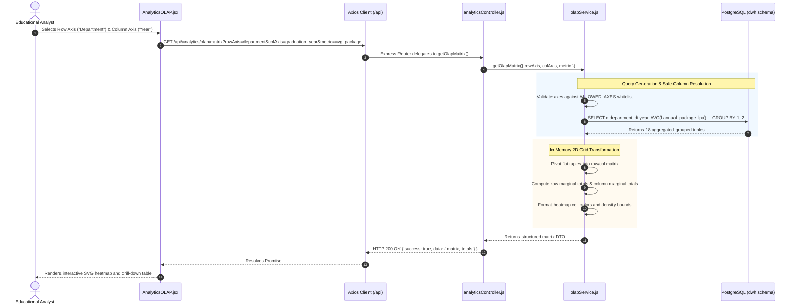

# 09. System Architecture and Runtime Topology

## 1. High-Level System Architecture

The DWM platform is engineered as a decoupled, three-tier analytical web application. It operates independently from the operational Alumni Portal, running dedicated frontend and backend runtime processes that interact with an analytical data warehouse hosted in the PostgreSQL `dwh` schema.

```mermaid
graph TD
    subgraph Client Tier ["Client Tier (Browser: React 18 + Vite)"]
        UI_Dash["Dashboard & KPIs<br/>(AnalyticsDashboard.jsx)"]
        UI_OLAP["OLAP Multidimensional Cube<br/>(AnalyticsOLAP.jsx)"]
        UI_Mine["Data Mining Suite<br/>(AnalyticsMining.jsx)"]
        UI_DWH["Warehouse Explorer & ERD<br/>(AnalyticsWarehouse.jsx)"]
        UI_CSV["CSV Ingestion & Ledger<br/>(AnalyticsCSVIngestion.jsx)"]
        API_Client["Axios HTTP Client<br/>(Base URL: /api)"]
    end

    subgraph Server Tier ["Server Tier (Node.js 20+ / Express.js)"]
        Router["Express API Router<br/>(/api/analytics/* & /api/datamining/*)"]
        Auth_MW["Decoupled Auth Middleware<br/>(allowGuestAnalytics)"]
        
        subgraph Controllers ["Controllers"]
            C_Analytics["analyticsController.js"]
            C_Mining["miningController.js"]
            C_CSV["csvIngestionController.js"]
            C_Overview["warehouseOverviewController.js"]
        end

        subgraph Service Layer ["Analytical & Mining Services"]
            S_OLAP["olapService.js<br/>(Cube Slicing, Dicing, Pivoting)"]
            S_Apriori["aprioriService.js<br/>(Candidate Gen & Pruning)"]
            S_KMeans["kmeansService.js<br/>(Multi-run K-Means, WCSS, Silhouette)"]
            S_Classify["classificationService.js<br/>(Logistic Reg, 80/20 Split, ROC)"]
            S_Skills["skillGapService.js<br/>(Supply vs Demand Matching)"]
            S_ETL["csvIngestionService.js<br/>(Validation & Referential Staging)"]
            S_Overview["warehouseOverviewService.js<br/>(Catalog & Row Audits)"]
        end

        subgraph DB Layer ["Database Layer"]
            Pool["dwh.js Connection Pool<br/>(PostgreSQL Client)"]
        end
    end

    subgraph Storage Tier ["Analytical Storage Tier (PostgreSQL / PGlite)"]
        DWH_Schema[("dwh Schema<br/>15 Tables / 56,732 Rows")]
        DWH_Dims["6 Conformed Dimensions<br/>(Student, Alumni, Company, Skill, Date, Job)"]
        DWH_Bridges["3 Multivalued Bridges<br/>(Student-Skill, Alumni-Skill, Job-Skill)"]
        DWH_Facts["4 Fact Tables<br/>(Placement, Applications, Salary, Outcomes)"]
        DWH_Ledger["2 Audit Ledgers<br/>(etl_batches, etl_batch_errors)"]
    end

    UI_Dash --> API_Client
    UI_OLAP --> API_Client
    UI_Mine --> API_Client
    UI_DWH --> API_Client
    UI_CSV --> API_Client

    API_Client -- "HTTP REST (Port 5001)" --> Router
    Router --> Auth_MW
    Auth_MW --> Controllers
    Controllers --> Service Layer
    Service Layer --> Pool
    Pool -- "TCP Socket (Port 54329)" --> DWH_Schema

    DWH_Schema --- DWH_Dims
    DWH_Schema --- DWH_Bridges
    DWH_Schema --- DWH_Facts
    DWH_Schema --- DWH_Ledger
```

---

## 2. Tier Breakdown & Technology Stack

### 2.1 Client Tier (Analytical UI)
- **Framework**: React 18.2.0 bundled with Vite 5.x.
- **Routing**: `react-router-dom` v6 with client-side history management.
- **Styling & Design System**: Tailwind CSS v3 with glassmorphic styling, responsive data grid layouts, and color-coded status badges.
- **Visual Analytics**: Recharts library (Bar charts, Line graphs, Scatter plots for PCA clusters, Radar charts for skill profiles) and Lucide React icons.
- **State & HTTP**: Axios instance with automated error interceptors, local component state hooks (`useState`, `useEffect`, `useMemo`), and optimistic UI updates for long-running mining computations.

### 2.2 Server Tier (Analytical Engine)
- **Runtime**: Node.js 20.x LTS.
- **Web Application Framework**: Express.js 4.19+.
- **Middleware**:
  - `cors`: Configured to permit cross-origin requests from development and production analytical clients.
  - `helmet`: HTTP header security.
  - `express.json()` and `multer`: Multi-part form data handling for CSV file uploads up to 25 MB.
  - `allowGuestAnalytics`: Decoupled middleware permitting unauthenticated analytical exploration across read-only visual endpoints, or optional JWT extraction when available.
- **Architecture Pattern**: Controller-Service-Repository pattern. Controllers handle HTTP request parsing and response envelopes; services encapsulate pure algorithmic logic (Apriori, K-Means, Logistic Regression) and transactional ETL staging; database pools execute parameterized SQL.

### 2.3 Storage Tier (Analytical Warehouse)
- **Database Engine**: Embedded PGlite or external PostgreSQL 16.
- **Port Allocation**: Port `54329` (dev embedded) or `5432` (production Postgres).
- **Schema Boundary**: Dedicated `dwh` schema containing all analytical tables. The operational `public` schema is physically isolated with zero cross-schema triggers, views, or foreign keys.

---

## 3. End-to-End Analytics Request Lifecycle

Below is the execution flow of an analytical query, using an OLAP 2D Matrix aggregation request as a representative lifecycle:



---

## 4. Runtime Isolation and Port Allocations

The operational Alumni Portal and the DWM Analytics Suite operate on completely distinct network ports and directory roots:

| Component | Repository Path | Dev Server Port | Primary Process Command | Role |
| :--- | :--- | :--- | :--- | :--- |
| **DWM Frontend** | `DWM-project/client` | `5174` | `npm run dev` (Vite) | Analytical dashboard, OLAP cube, data mining UI |
| **DWM Backend** | `DWM-project/server` | `5001` | `npm run dev` (Express) | Analytical REST APIs, ML models, Apriori engine |
| **Analytical DB** | Dedicated PostgreSQL | `54329` | `PGlite / PostgreSQL` | Isolated `dwh` schema hosting 15 tables |
| **Parent Portal Client**| `client/` | `5173` | `npm run dev` (Vite) | Operational Alumni web application |
| **Parent Portal Server**| `server/` | `5000` | `npm run dev` (Express) | Operational user auth, messaging, feeds |

---

## 5. Architectural Diagram Deliverables Reference

The architecture described above is fully specified in the following Mermaid diagram source files in [`diagrams/`](file:///c:/Users/HP/Desktop/Alumni-Network/DWM-project/docs/research-dossier/diagrams/):

1. **[`diagrams/01_system_architecture.mmd`](file:///c:/Users/HP/Desktop/Alumni-Network/DWM-project/docs/research-dossier/diagrams/01_system_architecture.mmd)**: End-to-end 3-tier view mapping client components, server middleware, data mining engines, and the isolated `dwh` database.
2. **[`diagrams/02_frontend_architecture.mmd`](file:///c:/Users/HP/Desktop/Alumni-Network/DWM-project/docs/research-dossier/diagrams/02_frontend_architecture.mmd)**: Component hierarchy, route views, shared Recharts/Lucide UI elements, and Axios client.
3. **[`diagrams/03_backend_architecture.mmd`](file:///c:/Users/HP/Desktop/Alumni-Network/DWM-project/docs/research-dossier/diagrams/03_backend_architecture.mmd)**: Middleware chain, controllers, domain services, repository abstraction, and PostgreSQL pool.
4. **[`diagrams/07_api_request_lifecycle.mmd`](file:///c:/Users/HP/Desktop/Alumni-Network/DWM-project/docs/research-dossier/diagrams/07_api_request_lifecycle.mmd)**: Component traversal from user interaction to SQL execution and DOM rendering.
5. **[`diagrams/08_analytics_sequence.mmd`](file:///c:/Users/HP/Desktop/Alumni-Network/DWM-project/docs/research-dossier/diagrams/08_analytics_sequence.mmd)**: Dual sequence diagram tracing synchronous OLAP matrix aggregation and multi-stage Apriori mining.
6. **[`diagrams/14_runtime_topology.mmd`](file:///c:/Users/HP/Desktop/Alumni-Network/DWM-project/docs/research-dossier/diagrams/14_runtime_topology.mmd)**: Process-level view of independent ports (5174/5001 vs 5173/5000) and schema isolation.

