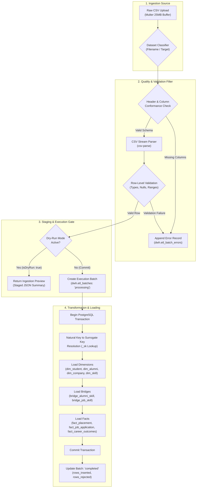

# 10. Data Ingestion Pipeline, ETL Staging, and Data Lineage

## 1. End-to-End Data Ingestion Architecture

The DWM data ingestion pipeline is implemented in [csvIngestionService.js](file:///c:/Users/HP/Desktop/Alumni-Network/DWM-project/server/src/services/dwh/csvIngestionService.js) and controller [csvIngestionController.js](file:///c:/Users/HP/Desktop/Alumni-Network/DWM-project/server/src/controllers/csvIngestionController.js). It replaces automated operational database replication with an audited, deterministic, and schema-validated batch loading pipeline.



---

## 2. Ingestion Execution Flow & Stages

### Stage 1: Upload Reception and Target Classification
- Incoming CSV payloads are received via multipart POST at `/api/analytics/ingest/upload`.
- The target dataset type is resolved (e.g., `'skills'`, `'alumni'`, `'jobs'`, `'alumni_skills'`, `'job_skills'`, `'applications'`, `'career_outcomes'`).

### Stage 2: Schema Conformance & Header Verification
- Required CSV headers are verified against defined schema specifications.
- If mandatory columns are missing, the entire batch is rejected before record parsing begins.

### Stage 3: Row-by-Row Quality Validation
- **Numeric & Domain Checks**:
  - `cgpa` must fall strictly within $0.0 \le \text{cgpa} \le 10.0$.
  - `annual_package_lpa` must be non-negative.
  - `employed_within_6_months` must be binary ($0$ or $1$).
- **Mandatory Non-Null Keys**: Records with null identifiers or empty natural keys are rejected.
- **Error Ledgering**: Every rejected record is logged with its exact row number, raw JSON record, and descriptive validation failure reason in `dwh.etl_batch_errors`.

### Stage 4: Dry-Run Staging Gate
- The ingestion service supports a preview flag (`isDryRun: true`).
- In dry-run mode, full row validation and surrogate key lookups execute without committing writes to the warehouse.
- A summary payload returns:
  - Total records evaluated
  - Passed records count
  - Failed records count
  - Sample valid records for UI preview
  - Sample validation errors

### Stage 5: Atomic Transactional Commit
- In live execution mode (`isDryRun: false`), all table inserts run within an atomic PostgreSQL transaction block (`BEGIN ... COMMIT`).
- If any referential constraint fails, the entire transaction rolls back (`ROLLBACK`), guaranteeing the data warehouse remains consistent.
- Surrogate keys (`_sk`) are generated or retrieved via SQL `ON CONFLICT` clauses.
- Upon completion, `dwh.etl_batches` records execution duration, timestamps, and total rows inserted.

---

## 3. CSV Dataset to Warehouse Table Lineage Mapping

Below is the verified lineage tracing raw CSV files to their physical destinations in the `dwh` schema:

| Raw CSV Dataset | Ingestion Parser Rule | Target Warehouse Table(s) | Natural Key $\rightarrow$ Surrogate Key Resolution |
| :--- | :--- | :--- | :--- |
| `skills.csv` | Direct dimension mapping | `dwh.dim_skill` | `skill_id` $\rightarrow$ `skill_sk` (Natural key preserved in `natural_skill_id`) |
| `alumni.csv` | Profile dimension mapping | `dwh.dim_alumni` | `alumni_id` $\rightarrow$ `alumni_sk` (Natural key preserved in `natural_alumni_id`) |
| `jobs.csv` | Requisition dimension mapping | `dwh.dim_job` | `job_id` $\rightarrow$ `job_sk`; `company_name` resolved to `dim_company.company_sk` |
| `alumni_skills.csv` | Bridge association mapping | `dwh.bridge_alumni_skill` | `alumni_id` resolved to `alumni_sk`; `skill_id` resolved to `skill_sk` |
| `job_skills.csv` | Bridge association mapping | `dwh.bridge_job_skill` | `job_id` resolved to `job_sk`; `skill_id` resolved to `skill_sk` |
| `applications.csv` | Fact application mapping | `dwh.fact_job_application`| `application_id` $\rightarrow$ `application_id`; `alumni_id` $\rightarrow$ `alumni_sk`; `job_id` $\rightarrow$ `job_sk` |
| `career_outcomes.csv` | Fact target mapping | `dwh.fact_career_outcomes`| `outcome_id` $\rightarrow$ `outcome_id`; `alumni_id` resolved to `dim_alumni.alumni_sk` |

---

## 4. Ingestion Audit Ledger History

The audit tables `dwh.etl_batches` and `dwh.etl_batch_errors` provide complete operational traceability:

- **Total Execution Batches Logged**: 137 batch runs.
- **Total Ingestion Exceptions Logged**: 46 error records.
- **Audit Logging Query**:
  ```sql
  SELECT b.id, b.file_name, b.status, b.rows_total, b.rows_inserted, b.rows_rejected, b.started_at
  FROM dwh.etl_batches b
  ORDER BY b.started_at DESC
  LIMIT 10;
  ```
- All batch history and error reports are directly accessible in the frontend through the CSV Ingestion & Audit Ledger interface (`/analytics/csv-ingest`).

---

## 5. Lineage and Ingestion Workflow Diagram References

The visual architecture for the ingestion lifecycle and dataset lineages is specified in:
- **ETL Staging and Processing Pipeline**: [`diagrams/06_etl_data_lineage.mmd`](file:///c:/Users/HP/Desktop/Alumni-Network/DWM-project/docs/research-dossier/diagrams/06_etl_data_lineage.mmd) details the 5-stage ingestion lifecycle, row validation filters, dry-run gate, and atomic transaction commit.
- **Dataset Relationships and Warehouse Mapping**: [`diagrams/05_dataset_relationships.mmd`](file:///c:/Users/HP/Desktop/Alumni-Network/DWM-project/docs/research-dossier/diagrams/05_dataset_relationships.mmd) illustrates the 7 physical CSV files, primary/foreign join keys, and their mapping into warehouse dimension, bridge, and fact tables.

