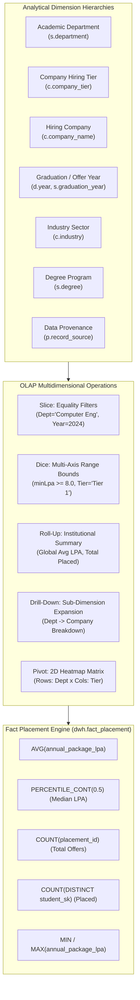

# 12. OLAP Multidimensional Engine and Visual Analytics

## 1. OLAP Dimensional Architecture

The DWM analytical platform incorporates a multidimensional Online Analytical Processing (OLAP) engine implemented in [warehouseRepository.js:getOlapData](file:///c:/Users/HP/Desktop/Alumni-Network/DWM-project/server/src/services/dwh/warehouseRepository.js#L503-L600) and rendered in frontend component [AnalyticsOLAP.jsx](file:///c:/Users/HP/Desktop/Alumni-Network/DWM-project/client/src/pages/analytics/AnalyticsOLAP.jsx).

The engine supports all five canonical OLAP operations across educational and placement facts:
1. **Roll-Up**: Aggregation from lower-level grains to higher-level summary hierarchies.
2. **Drill-Down**: Navigation from summary metrics to granular detail.
3. **Slice**: Equality filtering fixing one or more dimensions to specific constant values.
4. **Dice**: Multidimensional bounding box filtering (e.g., salary thresholds combined with academic cohorts).
5. **Pivot / Cross-Tabulation**: Dynamic 2D matrix transformation projecting two arbitrary dimensions across row and column axes with automated marginal totals.



---

## 2. Mathematical Definition of Aggregations & Measures

The OLAP engine queries `dwh.fact_placement` joined with `dim_student`, `dim_company`, and `dim_date`. All measures are strictly defined without heuristic inflation:

### 2.1 Additive Measures
- **Total Placement Offers**:
  $$\text{Total Offers} = \sum_{i \in \text{Partition}} 1 = \text{COUNT}(p.\text{placement\_id})$$
- **Placed Unique Students**:
  $$\text{Placed Students} = \text{COUNT}(\text{DISTINCT } p.\text{student\_sk})$$
- **Eligible Candidates**:
  $$\text{Eligible Students} = \text{COUNT}(\text{DISTINCT } s.\text{student\_sk})$$

### 2.2 Semi-Additive & Statistical Measures
- **Mean Annual Compensation (LPA)**:
  $$\text{Avg LPA} = \frac{1}{N} \sum_{i=1}^{N} p.\text{annual\_package\_lpa}_i$$
- **True Median Compensation (50th Percentile)**:
  $$\text{Median LPA} = \text{PERCENTILE\_CONT}(0.5) \text{ WITHIN GROUP } (\text{ORDER BY } p.\text{annual\_package\_lpa})$$
  *Note*: Many analytical systems approximate the median using average metrics; the DWM warehouse computes the exact continuous 50th percentile in PostgreSQL.
- **Compensation Range Bounds**:
  $$\text{Max LPA} = \max_{i} (p.\text{annual\_package\_lpa}_i), \quad \text{Min LPA} = \min_{i} (p.\text{annual\_package\_lpa}_i)$$

---

## 3. Operational Mechanics of OLAP Operations

### 3.1 Slicing (Equality Dimension Constraints)
Slicing isolates a hyperplane through the multidimensional cube by fixing dimension values. The service maps slice parameters into SQL prepared statements:
- **Department Slice**: `s.department = $1`
- **Corporate Tier Slice**: `c.company_tier = $2`
- **Hiring Company Slice**: `c.company_name ILIKE $3`
- **Graduation Year Slice**: `COALESCE(d.year, s.graduation_year) = $4`
- **Industry Slice**: `c.industry = $5`
- **Data Provenance Slice**: `p.record_source = $6`

### 3.2 Dicing (Multidimensional Bounding Boxes)
Dicing restricts the analysis to a sub-cube defined by multiple constraints across dimensions and measure bounds:
- **Salary Threshold**: `p.annual_package_lpa >= $minLpa`
- When combined with department or cohort filters, dicing isolates high-package placement segments (e.g., packages $\ge 12.0\text{ LPA}$ in Computer Engineering for 2024 graduates).

### 3.3 Roll-Up (Institutional Summarization)
In parallel with grouped dimension aggregation, the backend executes an institutional roll-up query applying the identical slice and dice constraints over the entire cube:
```sql
SELECT 
  COUNT(p.placement_id)::int as total_offers,
  COUNT(DISTINCT p.student_sk)::int as total_placed,
  ROUND(COALESCE(AVG(p.annual_package_lpa), 0), 2) as overall_avg_lpa,
  ROUND(COALESCE(PERCENTILE_CONT(0.5) WITHIN GROUP (ORDER BY p.annual_package_lpa), 0)::numeric, 2) as overall_median_lpa,
  ROUND(COALESCE(MAX(p.annual_package_lpa), 0), 2) as overall_max_lpa,
  ROUND(COALESCE(MIN(p.annual_package_lpa), 0), 2) as overall_min_lpa
FROM dwh.fact_placement p
JOIN dwh.dim_student s ON s.student_sk = p.student_sk
JOIN dwh.dim_company c ON c.company_sk = p.company_sk
LEFT JOIN dwh.dim_date d ON d.date_sk = p.offer_date_sk
${whereClause};
```

### 3.4 Drill-Down (Hierarchical Exploration)
When an analyst selects a dimension partition (e.g., clicking on `department = 'Information Technology'`), passing `drillDownKey` expands the aggregated record into constituent company offers and individual role breakdowns.

### 3.5 2D Matrix Pivoting (Cross-Tabulation)
When a secondary dimension is specified (e.g., Row Axis = `department`, Column Axis = `company_tier`):
1. The SQL engine executes a two-dimensional `GROUP BY primaryCol, secondaryCol`.
2. The service transforms flat database tuples into a 2D matrix structure.
3. For each cell $(r, c)$, the selected measure (e.g., `avg_lpa` or `placed_count`) is populated.
4. Row marginal totals ($\sum_c M_{r,c}$) and column marginal totals ($\sum_r M_{r,c}$) are calculated automatically.
5. In the UI, cells render with relative opacity heatmaps proportional to value density.

---

## 4. Dimension Whitelist and SQL Injection Immunity

To prevent SQL injection while allowing dynamic multidimensional projection, [warehouseRepository.js](file:///c:/Users/HP/Desktop/Alumni-Network/DWM-project/server/src/services/dwh/warehouseRepository.js#L516-L525) uses an immutable dimension map:

```javascript
const allowedDimensions = {
  department: 's.department',
  tier: 'c.company_tier',
  company: 'c.company_name',
  year: 'COALESCE(d.year, s.graduation_year)',
  industry: 'c.industry',
  degree: 's.degree',
  source: 'p.record_source',
}
```

Any parameter not matching this whitelist defaults to `s.department`. Column identifiers are never interpolated directly from raw HTTP request inputs.

---

## 5. OLAP Workflow & Sequence Diagram References

The complete architectural flow and synchronous execution sequence of the OLAP engine are specified in:
- **OLAP Cube Engine & Workflow**: [`diagrams/09_olap_workflow.mmd`](file:///c:/Users/HP/Desktop/Alumni-Network/DWM-project/docs/research-dossier/diagrams/09_olap_workflow.mmd) details dimension input, slice/dice/rollup/drill/pivot engines, SQL prepared statements, exact continuous median calculation, and in-memory matrix projection.
- **OLAP Request Sequence Lifecycle**: [`diagrams/08_analytics_sequence.mmd`](file:///c:/Users/HP/Desktop/Alumni-Network/DWM-project/docs/research-dossier/diagrams/08_analytics_sequence.mmd#L16-L37) (Workflow A) traces the synchronous sequence from UI filter selection through controller routing, SQL aggregation, matrix marginal totaling, and SVG heatmap DOM rendering.

