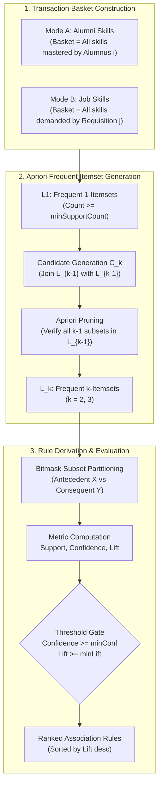

# 13. Association Rule Mining Methodology and the Apriori Algorithm

## 1. Algorithmic Foundation & Objective

Association rule mining discovers latent co-occurrence patterns, co-requisite skill clusters, and career pathways in the data warehouse. Implemented in [associationRulesService.js](file:///c:/Users/HP/Desktop/Alumni-Network/DWM-project/server/src/services/datamining/associationRulesService.js), the module uses the **Apriori Algorithm** (Agrawal & Srikant, 1994) to extract frequent itemsets and derive actionable association rules ($X \Rightarrow Y$).

In institutional analytics, association mining answers critical curricular questions:
- *Which technical competencies are co-acquired by alumni in high-tier corporate positions?*
- *Which skill bundles are co-demanded by enterprise job requisitions?*
- *When a student masters Skill A and Skill B, what is the probability and lift of requiring Skill C?*



---

## 2. Mathematical Formulations and Metrics

Let $I = \{i_1, i_2, \dots, i_m\}$ be the universe of unique skills ($|I| = 150$), and $D = \{t_1, t_2, \dots, t_N\}$ be the transaction database of size $N$. An itemset $X \subseteq I$ has support count $\sigma(X) = |\{t \in D \mid X \subseteq t\}|$.

### 2.1 Support
The relative frequency of an itemset $X$ or rule $X \Rightarrow Y$ across the entire transaction database:
$$\text{Support}(X) = \frac{\sigma(X)}{N}$$
$$\text{Support}(X \Rightarrow Y) = \text{Support}(X \cup Y) = \frac{\sigma(X \cup Y)}{N}$$

### 2.2 Confidence
The conditional probability that a transaction contains consequent $Y$ given that it contains antecedent $X$:
$$\text{Confidence}(X \Rightarrow Y) = P(Y \mid X) = \frac{\text{Support}(X \cup Y)}{\text{Support}(X)} = \frac{\sigma(X \cup Y)}{\sigma(X)}$$
- Measures rule reliability. A confidence of $0.75$ indicates that 75% of alumni possessing skill set $X$ also possess skill set $Y$.

### 2.3 Lift
The ratio of observed joint support to expected support under statistical independence:
$$\text{Lift}(X \Rightarrow Y) = \frac{\text{Confidence}(X \Rightarrow Y)}{\text{Support}(Y)} = \frac{\text{Support}(X \cup Y)}{\text{Support}(X) \times \text{Support}(Y)}$$
- $\text{Lift} = 1.0$: $X$ and $Y$ appear together purely by random chance.
- $\text{Lift} > 1.0$: Positive correlation. The presence of antecedent $X$ significantly increases the likelihood of consequent $Y$.
- $\text{Lift} < 1.0$: Negative correlation / substitution effect.

---

## 3. Implementation Details

### 3.1 Candidate Generation & The Apriori Property
The Apriori principle states: *All non-empty subsets of a frequent itemset must also be frequent.*
In `generateCandidateItemsets(frequentKeys, k)`:
1. **Join Condition**: Two itemsets $A, B \in L_{k-1}$ are merged into candidate $C_k = A \cup B$ only if their first $k-2$ sorted items are identical:
   $$A[0 \dots k-3] == B[0 \dots k-3]$$
2. **Apriori Pruning**: Before scanning transactions, the algorithm verifies that all $k$ subsets of size $k-1$ within candidate $C_k$ exist in $L_{k-1}$. Any candidate violating this condition is pruned in $O(k)$ time.

### 3.2 Proper Non-Empty Subset Generation
Rule derivation decomposes each frequent itemset $S \in L_k$ ($k \ge 2$) into disjoint antecedent $X$ and consequent $Y$ ($X \cup Y = S, X \cap Y = \emptyset, X \neq \emptyset, Y \neq \emptyset$).
This is implemented via bitmasking:
```javascript
const totalCombinations = 1 << items.length
for (let mask = 1; mask < totalCombinations - 1; mask++) {
  // Extract items where bit is 1 into antecedent, bit 0 into consequent
}
```

---

## 4. Operational Modes: Mode A vs Mode B

The DWM platform implements two transaction extraction modes:

| Dimension | Mode A: Alumni Professional Competencies | Mode B: Enterprise Job Requisition Demands |
| :--- | :--- | :--- |
| **Transaction Entity** | Individual Alumnus (`alumni_sk`) | Job Requisition Posting (`job_sk`) |
| **Warehouse Source** | `dwh.bridge_alumni_skill` JOIN `dim_skill` | `dwh.bridge_job_skill` JOIN `dim_skill` |
| **Transaction Count** | $N = 2,000$ alumni profiles | $N = 5,000$ corporate job postings |
| **Average Basket Size**| ~10.0 skills / alumnus | ~3.0 skills / job posting |
| **Default Thresholds** | $\text{minSupport} = 5\%$, $\text{minConfidence} = 50\%$, $\text{minLift} = 1.1\times$ | $\text{minSupport} = 3\%$, $\text{minConfidence} = 40\%$, $\text{minLift} = 1.1\times$ |
| **Typical Finding** | Core full-stack and cloud bundles (e.g., Docker + Kubernetes $\Rightarrow$ AWS) | Targeted requirement pairs (e.g., React + TypeScript $\Rightarrow$ Node.js) |

---

## 5. Illustrative Worked Example

Consider a toy database of $N = 5$ alumni profiles:
- $T_1 = \{\text{Python, SQL, Docker}\}$
- $T_2 = \{\text{Python, SQL}\}$
- $T_3 = \{\text{Python, Docker, AWS}\}$
- $T_4 = \{\text{SQL, Java}\}$
- $T_5 = \{\text{Python, SQL, Docker, AWS}\}$

Let $\text{minSupport} = 0.40$ ($\text{count} \ge 2$) and $\text{minConfidence} = 0.60$:
1. **$L_1$ Support Counts**:
   - $\text{Python}: 4/5 = 0.80$
   - $\text{SQL}: 4/5 = 0.80$
   - $\text{Docker}: 3/5 = 0.60$
   - $\text{AWS}: 2/5 = 0.40$
   - $\text{Java}: 1/5 = 0.20$ (Pruned)
2. **$L_2$ Frequent 2-Itemsets**:
   - $\{\text{Python, SQL}\}: 3/5 = 0.60$
   - $\{\text{Python, Docker}\}: 3/5 = 0.60$
   - $\{\text{Python, AWS}\}: 2/5 = 0.40$
   - $\{\text{SQL, Docker}\}: 2/5 = 0.40$
   - $\{\text{Docker, AWS}\}: 2/5 = 0.40$
3. **Derived Association Rule**: $\{\text{Docker}\} \Rightarrow \{\text{Python}\}$
   - $\text{Support}(\{\text{Docker, Python}\}) = 0.60$
   - $\text{Confidence} = \frac{0.60}{\text{Support}(\text{Docker})} = \frac{0.60}{0.60} = 1.00$ ($100\%$)
   - $\text{Lift} = \frac{1.00}{\text{Support}(\text{Python})} = \frac{1.00}{0.80} = 1.25\times$
   - *Interpretation*: Every alumnus with Docker also possesses Python, representing a 25% lift above baseline Python occurrence.

---

## 6. Apriori Workflow Diagram References

The complete architectural flow and algorithmic execution sequence for the Apriori association engine are specified in:
- **Apriori Algorithm Workflow**: [`diagrams/10_apriori_workflow.mmd`](file:///c:/Users/HP/Desktop/Alumni-Network/DWM-project/docs/research-dossier/diagrams/10_apriori_workflow.mmd) details Mode A vs Mode B transaction extraction, candidate generation ($C_k$), subset pruning, support counting, bitmask rule derivation, and threshold filtering.
- **Apriori Mining Sequence**: [`diagrams/08_analytics_sequence.mmd`](file:///c:/Users/HP/Desktop/Alumni-Network/DWM-project/docs/research-dossier/diagrams/08_analytics_sequence.mmd#L39-L64) (Workflow B) traces the end-to-end execution sequence from the `/analytics/mining` interface to database basket extraction and ranked rule delivery.

