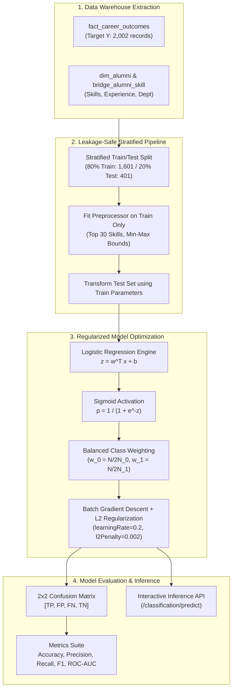

# 14. Supervised Classification Methodology and Career Outcomes Prediction

## 1. Problem Formulation & Institutional Motivation

Predicting educational and career outcomes is a core institutional research priority. Accreditation agencies (e.g., NAAC, NIRF) evaluate higher education institutions on graduate employability within 6 months of program completion.

Implemented in [classificationService.js](file:///c:/Users/HP/Desktop/Alumni-Network/DWM-project/server/src/services/datamining/classificationService.js), the supervised classification engine predicts the binary target variable:
$$Y = \text{employed\_within\_6\_months} \in \{0, 1\}$$
from longitudinal alumni features, competency vectors, and academic indicators stored in `dwh.fact_career_outcomes` and conformed dimension `dwh.dim_alumni`.

---

## 2. Mathematical Foundation of the Classifier

### 2.1 Logistic Regression Model
For a feature vector $\mathbf{x} \in \mathbb{R}^d$, the linear combination is given by:
$$z = b + \sum_{j=1}^d w_j x_j = \mathbf{w}^T \mathbf{x} + b$$
The posterior probability of positive employment is parameterized by the standard logistic (sigmoid) function:
$$P(Y = 1 \mid \mathbf{x}) = \sigma(z) = \frac{1}{1 + e^{-z}}$$
To protect against numerical overflow, the sigmoid implementation clips extreme values:
$$\sigma(z) = \begin{cases} 1.0 & \text{if } z \ge 40 \\ 0.0 & \text{if } z \le -40 \\ \frac{1}{1 + e^{-z}} & \text{otherwise} \end{cases}$$

### 2.2 Balanced Class Weighting & Loss Function
The dataset exhibits an empirical class imbalance ($69.8\%$ positive vs $30.2\%$ negative). To prevent the optimization from degenerating into a majority-class classifier, balanced class weights are introduced:
$$w_0 = \frac{N}{2 \cdot N_0}, \quad w_1 = \frac{N}{2 \cdot N_1}$$
The weighted negative log-likelihood loss with $L_2$ regularization is defined as:
$$J(\mathbf{w}, b) = -\frac{1}{N} \sum_{i=1}^N \Big[ w_{y_i} \cdot \big( y_i \ln \hat{y}_i + (1 - y_i) \ln (1 - \hat{y}_i) \big) \Big] + \frac{\lambda}{2} \|\mathbf{w}\|_2^2$$
where $\hat{y}_i = \sigma(\mathbf{w}^T \mathbf{x}_i + b)$ and $\lambda$ is the $L_2$ penalty parameter (`l2Penalty = 0.002`).

### 2.3 Batch Gradient Descent Updates
At each training epoch ($T = 350$), the weights and bias update via:
$$\mathbf{w} \leftarrow \mathbf{w} - \eta \left( \frac{1}{N} \sum_{i=1}^N e_i \mathbf{x}_i + \lambda \mathbf{w} \right)$$
$$b \leftarrow b - \eta \left( \frac{1}{N} \sum_{i=1}^N e_i \right)$$
where $e_i = (\hat{y}_i - y_i) \cdot w_{y_i}$ is the weighted prediction error and $\eta = 0.2$ is the learning rate.

---

## 3. Data Preprocessing & Data-Leakage Immunity

A common pitfall in academic machine learning pipelines is **data leakage**, where global dataset statistics (such as mean, min, max, or frequent vocabulary) are calculated over the entire dataset before splitting.

The DWM classification pipeline enforces strict data leakage isolation in [classificationService.js:fitPreprocessor](file:///c:/Users/HP/Desktop/Alumni-Network/DWM-project/server/src/services/datamining/classificationService.js#L29-L87):
1. **Stratified Partitioning**: The dataset is split into **80% Training ($n = 1,601$)** and **20% Test ($n = 401$)** using `stratifiedTrainTestSplit`, ensuring identical positive/negative ratios across partitions.
2. **Training-Only Feature Selection**: The top 30 most frequent skills are extracted strictly from the 1,601 training instances. Skills appearing only in the test set are not used to build vocabulary.
3. **Training-Only Scaling**: Min-max normalization bounds for experience ($\text{minExp}, \text{maxExp}$) are computed solely from the training partition:
   $$x_{\text{norm\_exp}} = \frac{x_{\text{raw\_exp}} - \text{minExp}_{\text{train}}}{\text{maxExp}_{\text{train}} - \text{minExp}_{\text{train}}}$$
4. **Final Feature Vector Dimension ($d = 32$)**:
   $$\mathbf{x} = [\underbrace{s_1, s_2, \dots, s_{30}}_{\text{Binary Skill Indicators } (0 \text{ or } 1)}, \underbrace{\text{norm\_experience}}_{\text{Continuous } [0, 1]}, \underbrace{\text{norm\_skill\_count}}_{\text{Continuous } [0, 1]}]$$

---

## 4. Evaluation Suite and Metrics

Evaluation runs on the held-out 20% test partition ($n = 401$ instances).

### 4.1 Confusion Matrix Layout
$$\begin{array}{c|cc}
 & \text{Predicted Negative } (\hat{Y}=0) & \text{Predicted Positive } (\hat{Y}=1) \\
\hline
\text{Actual Negative } (Y=0) & \text{True Negative (TN)} & \text{False Positive (FP)} \\
\text{Actual Positive } (Y=1) & \text{False Negative (FN)} & \text{True Positive (TP)} \\
\end{array}$$

### 4.2 Comprehensive Metric Formulations
- **Accuracy**: $\frac{\text{TP} + \text{TN}}{\text{TP} + \text{TN} + \text{FP} + \text{FN}}$
- **Precision (Positive Predictive Value)**: $\frac{\text{TP}}{\text{TP} + \text{FP}}$
- **Recall (Sensitivity)**: $\frac{\text{TP}}{\text{TP} + \text{FN}}$
- **Specificity (True Negative Rate)**: $\frac{\text{TN}}{\text{TN} + \text{FP}}$
- **Balanced Accuracy**: $\frac{\text{Recall} + \text{Specificity}}{2}$
- **$F_1$-Score**: $2 \cdot \frac{\text{Precision} \cdot \text{Recall}}{\text{Precision} + \text{Recall}}$
- **ROC-AUC (Area Under the Receiver Operating Characteristic)**: Computed across continuous decision thresholds $\theta \in [0.0, 1.0]$.

---

## 5. Supervised Classification Workflow Diagram Reference

The end-to-end machine learning pipeline, data-leakage prevention shield, and mathematical optimization steps are visually modeled in:
- **Classification Pipeline & Leakage Prevention**: [`diagrams/11_classification_workflow.mmd`](file:///c:/Users/HP/Desktop/Alumni-Network/DWM-project/docs/research-dossier/diagrams/11_classification_workflow.mmd) details the stratified 80/20 train/test split, frozen preprocessor scaling, batch gradient descent with balanced weights, confusion matrix evaluation, and interactive single-record inference.

