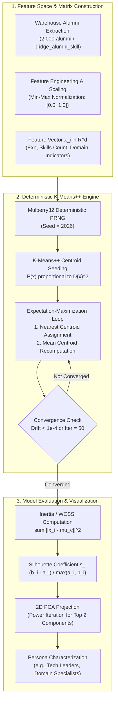

# 15. Unsupervised Clustering Methodology and Profile Segmentation

## 1. Algorithmic Objectives & Educational Context

Unsupervised clustering segments alumni and students into natural behavioural and competency cohorts without requiring ground-truth labels. Implemented in [clusteringService.js](file:///c:/Users/HP/Desktop/Alumni-Network/DWM-project/server/src/services/datamining/clusteringService.js), the clustering engine uses **K-Means with K-Means++ initialization** and a deterministic seeded pseudo-random number generator.

In higher-education intelligence, clustering addresses institutional questions:
- *What distinct graduate archetypes emerge from longitudinal career trajectories?*
- *Can we segment students by academic performance and test readiness to target placement coaching?*
- *How are skill proficiencies clustered into multi-disciplinary talent pools?*



---

## 2. Mathematical Formulations

### 2.1 Distance Metric & Optimization Objective
Let $X = \{\mathbf{x}_1, \mathbf{x}_2, \dots, \mathbf{x}_n\} \subset \mathbb{R}^d$ be the normalized feature matrix ($n = 2,000$ alumni). The objective is to partition $X$ into $K$ disjoint clusters $C = \{C_1, C_2, \dots, C_K\}$ minimizing the **Within-Cluster Sum of Squares (WCSS / Inertia)**:
$$J(C) = \sum_{k=1}^K \sum_{\mathbf{x}_i \in C_k} \|\mathbf{x}_i - \boldsymbol{\mu}_k\|_2^2$$
where $\boldsymbol{\mu}_k = \frac{1}{|C_k|} \sum_{\mathbf{x}_i \in C_k} \mathbf{x}_i$ is the centroid of cluster $C_k$, and $\|\cdot\|_2^2$ denotes squared Euclidean distance:
$$\|\mathbf{u} - \mathbf{v}\|_2^2 = \sum_{j=1}^d (u_j - v_j)^2$$

### 2.2 K-Means++ Initialization
Standard random centroid initialization is vulnerable to suboptimal local minima. The DWM platform uses **K-Means++** (Arthur & Vassilvitskii, 2007):
1. The first centroid $\boldsymbol{\mu}_1$ is selected uniformly at random from $X$ using the deterministic Mulberry32 PRNG.
2. For each point $\mathbf{x} \in X$, compute the minimum squared distance to all existing centroids:
   $$D(\mathbf{x})^2 = \min_{j \in \{1, \dots, m\}} \|\mathbf{x} - \boldsymbol{\mu}_j\|_2^2$$
3. The next centroid $\boldsymbol{\mu}_{m+1}$ is sampled from $X$ with probability proportional to $D(\mathbf{x})^2$:
   $$P(\mathbf{x}) = \frac{D(\mathbf{x})^2}{\sum_{\mathbf{x}' \in X} D(\mathbf{x}')^2}$$
4. Repeat Steps 2–3 until $K$ initial centroids are established.

### 2.3 Deterministic Reproducibility via Mulberry32 PRNG
To eliminate stochastic variability across academic demonstrations, the system implements a 32-bit Mulberry32 PRNG initialized with fixed seed `2026`:
```javascript
function createPrng(seed = 2026) {
  let a = seed >>> 0
  return function next() {
    a = (a + 0x6d2b79f5) | 0
    let t = Math.imul(a ^ (a >>> 15), 1 | a)
    t = (t + Math.imul(t ^ (t >>> 7), 61 | t)) ^ t
    return ((t ^ (t >>> 14)) >>> 0) / 4294967296
  }
}
```

---

## 3. Multi-$K$ Evaluation: Elbow Method & Silhouette Analysis

The service evaluates clustering quality across candidate cluster counts $K \in \{2, 3, 4, 5, 6, 7, 8\}$:

### 3.1 Inertia (Elbow Method)
As $K$ increases, WCSS monotonically decreases. The optimal $K$ corresponds to the inflection point ("elbow") beyond which additional clusters yield diminishing returns in error reduction.

### 3.2 Silhouette Analysis
For point $\mathbf{x}_i \in C_A$:
1. $a(i) = \frac{1}{|C_A| - 1} \sum_{\mathbf{x}_j \in C_A, j \neq i} \|\mathbf{x}_i - \mathbf{x}_j\|$: Mean intra-cluster distance.
2. $b(i) = \min_{C_B \neq C_A} \frac{1}{|C_B|} \sum_{\mathbf{x}_j \in C_B} \|\mathbf{x}_i - \mathbf{x}_j\|$: Mean nearest-cluster distance.
3. The silhouette coefficient $s(i)$ is:
   $$s(i) = \frac{b(i) - a(i)}{\max(a(i), b(i))} \in [-1.0, 1.0]$$
The global silhouette score $S = \frac{1}{n} \sum_{i=1}^n s(i)$ quantifies cluster separation and cohesion.

---

## 4. Dimensionality Reduction: 2D Principal Component Analysis (PCA)

High-dimensional cluster assignments cannot be directly plotted on 2D screens. The service computes a deterministic **2D PCA projection** in [featureEngineeringService.js:computePCA2D](file:///c:/Users/HP/Desktop/Alumni-Network/DWM-project/server/src/services/datamining/featureEngineeringService.js):
1. **Centering**: The feature matrix is mean-centered: $\tilde{X} = X - \bar{X}$.
2. **Covariance Matrix**: $\Sigma = \frac{1}{n} \tilde{X}^T \tilde{X} \in \mathbb{R}^{d \times d}$.
3. **Power Iteration with Deflation**: Computes the top two eigenvectors $\mathbf{v}_1, \mathbf{v}_2$ corresponding to the largest eigenvalues $\lambda_1, \lambda_2$.
4. **Projection**:
   $$\mathbf{z}_i = [\tilde{\mathbf{x}}_i^T \mathbf{v}_1, \tilde{\mathbf{x}}_i^T \mathbf{v}_2] \in \mathbb{R}^2$$
The resulting coordinates $(z_{i,1}, z_{i,2})$ power interactive SVG scatter plots in the frontend data mining dashboard.

---

## 5. Unsupervised Clustering Workflow Diagram Reference

The algorithmic stages, seed-invariance guarantees, and PCA projection are visually modeled in:
- **Clustering & PCA Projection Workflow**: [`diagrams/12_clustering_workflow.mmd`](file:///c:/Users/HP/Desktop/Alumni-Network/DWM-project/docs/research-dossier/diagrams/12_clustering_workflow.mmd) details feature extraction, Mulberry32 PRNG seed invariance, K-Means++ centroid initialization, Lloyd's optimization iterations, multi-$K$ Elbow and Silhouette evaluation, and Power Iteration 2D PCA projection.

