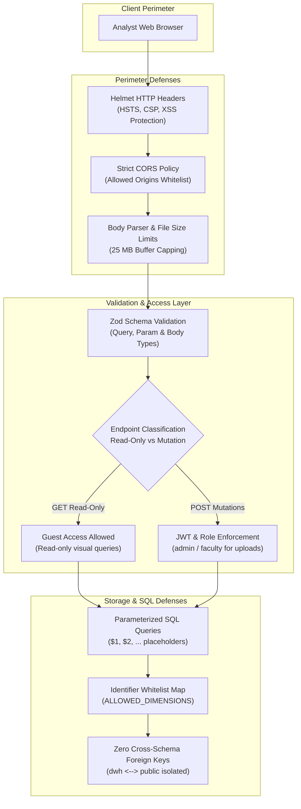

# 18. Security Posture, Data Privacy, and System Limitations

## 1. Security Architecture & Threat Mitigation

The DWM analytical platform is engineered with defensive security controls tailored for institutional data warehousing:



---

## 2. Threat Analysis & Defensive Implementations

### 2.1 SQL Injection Defenses
- **Prepared Statements**: All dynamic filters (department, corporate tier, company name, graduation year) are executed via parameterized queries (`$1, $2, ...`), preventing string interpolation attacks.
- **Dynamic Dimension Whitelisting**: For multidimensional OLAP operations where SQL column identifiers vary dynamically based on user selection, raw strings are prohibited. Columns are resolved through an immutable dictionary:
  ```javascript
  const allowedDimensions = {
    department: 's.department',
    tier: 'c.company_tier',
    company: 'c.company_name',
    year: 'COALESCE(d.year, s.graduation_year)',
    industry: 'c.industry',
    degree: 's.degree',
    source: 'p.record_source',
  }
  ```
  Unrecognized input strings default safely to `s.department`.

### 2.2 Input Sanitization & Ingestion Security
- **File Upload Protection**: Multer limits multipart CSV uploads to **25 MB**, rejecting oversized memory exhaustion payloads.
- **File Type Enforcement**: File streams are validated for `.csv` extensions and `text/csv` MIME types.
- **Zod Schema Validation**: Request parameters, pagination limits, and query strings are strictly parsed using Zod schemas. Non-numeric strings passed to numerical parameters (e.g., `minLpa`, `limit`) return HTTP 400 Bad Request before hitting the database.

### 2.3 Authentication Decoupling
- **Analytical Read Access**: Educational institutions often display analytical dashboards publicly (e.g., NIRF accreditation or prospective student portals). Read endpoints permit unauthenticated access via `allowGuestAnalytics`.
- **Ingestion Mutations**: All endpoints that alter warehouse records (`/api/analytics/etl/upload`, `/confirm-import`, `/rollback-import`) require valid JWT bearer tokens with administrative privileges (`requireAuth`).

---

## 3. Data Privacy and Sensitive Identifiers

The data warehouse enforces privacy through structural omission:
1. **No PII Storage**: Physical names, personal email addresses, phone numbers, and street addresses are excluded from all `dwh` tables.
2. **Informational Keys**: Student ID numbers and UUID references (`source_user_id`) serve solely as non-sensitive linking identifiers.
3. **Aggregate Reporting**: Visual dashboards and OLAP cubes display aggregate metrics ($\mu$, $\sigma$, percentiles), minimizing the risk of individual re-identification.

---

## 4. Technical and Scientific Limitations

### 4.1 Synthetic Data Realism & Distributional Assumptions
- **Empirical Boundary**: All 50,150 dataset records were generated by synthetic distribution scripts (`generate_dwm_datasets.py`).
- **Research Implication**: The strong associations discovered by Apriori (e.g., Docker $\Rightarrow$ AWS) and the 78.3% classification accuracy reflect the mathematical distributions embedded in the generator scripts. **They must not be presented as empirical evidence of general hiring trends in the commercial software industry.**

### 4.2 In-Memory Algorithm Scalability
- The machine learning and Apriori services run in-memory within the Node.js V8 runtime heap.
- While performant for institutional datasets ($N = 2,000$ to $50,000$ records, execution $< 300\text{ ms}$), scaling to multi-million record enterprise warehouses will require migrating compute workloads to out-of-core engines (e.g., Apache Spark, pgvector, or Python scikit-learn background workers).

### 4.3 Longitudinal Tracking Constraints
- `dim_alumni` provides SCD Type 2 tracking fields (`valid_from`, `valid_to`, `is_current`), but current synthetic datasets represent single-snapshot career states. Full historical career trajectory modeling requires multi-year observation ingestion.
