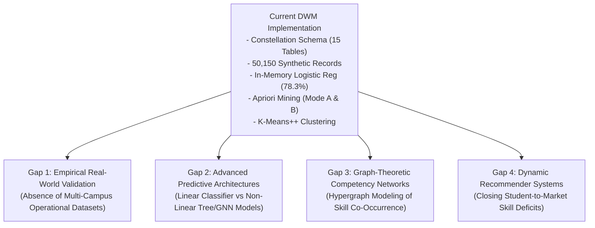

# 19. Research Gaps, Hypotheses, and Future Work Roadmap

## 1. Identified Research and Engineering Gaps

The DWM project provides a robust foundation for institutional data warehousing and educational data mining. However, critical research gaps remain that present valuable opportunities for future academic research and system evolution:

---

## 2. Proposed Research Agendas & Hypotheses

### Agenda 1: Non-Linear Ensemble vs Linear Models for Career Trajectory Prediction
- **Problem Statement**: The current classifier implements regularized Logistic Regression assuming linear decision boundaries in normalized skill-space. Do non-linear ensemble models (Gradient Boosted Decision Trees, Random Forests) or Deep Learning models improve sensitivity on the minority class (unemployed graduates)?
- **Hypothesis**: *Gradient Boosted Decision Trees (XGBoost) will demonstrate statistically significant improvements in ROC-AUC ($\Delta \text{AUC} \ge 0.08$) and recall on underrepresented engineering disciplines compared to regularized linear baselines.*
- **Evaluation Plan**:
  - Implement 5-fold cross-validation.
  - Baselines: Zero-R (Majority class), Logistic Regression (current), Random Forest, XGBoost.
  - Metrics: Macro-F1, ROC-AUC, Brier score, and SHAP (SHapley Additive exPlanations) values for global feature attribution.

### Agenda 2: Graph Neural Networks (GNN) on Higher-Ed Knowledge Graphs
- **Problem Statement**: Student-skill-job relationships form a natural heterogeneous information network (HIN). Relational table joins and flat feature vectors discard structural topological relationships.
- **Hypothesis**: *A Heterogeneous Graph Neural Network (HAN / HGT) trained on bipartite student-skill and job-skill subgraphs will predict student-job compatibility with higher precision than isolated ATS keyword matching.*
- **Methodology**:
  - Node types: $\mathcal{V} = \{\text{Student}, \text{Alumni}, \text{Skill}, \text{Company}, \text{Job}\}$.
  - Edge types: $\mathcal{E} = \{\text{proficient\_in}, \text{demands}, \text{placed\_at}, \text{applied\_to}\}$.
  - Evaluation: Link prediction accuracy and ranking metrics (MRR, NDCG@10).

### Agenda 3: Closed-Loop Curricular Recommendation System
- **Problem Statement**: While the platform identifies institutional skill deficits via `GET /api/analytics/skills`, it does not automatically prescribe personalized learning pathways to close the gap.
- **Research Question**: *Can an automated recommender system using Apriori association rules and market vacancy weights dynamically generate personalized course and certification suggestions that maximize a student's placement probability?*

---

## 3. Engineering and Scalability Roadmap

| Horizon | Engineering Objective | Proposed Technical Architecture | Expected Outcome |
| :--- | :--- | :--- | :--- |
| **Short-Term (3 Months)** | Out-of-Core ML Training | Python FastAPI microservice wrapping `scikit-learn` and `lightgbm` | Support datasets $> 1,000,000$ rows without Node.js heap exhaustion |
| **Medium-Term (6 Months)**| Real-Time Streaming Ingestion | Apache Kafka message bus with Debezium CDC | Near-instantaneous analytical cube refresh upon transactional commits |
| **Long-Term (12 Months)** | Cross-Institutional Federation | Multi-tenant schema isolation with differential privacy | Collaborative cross-university benchmarking without data exposure |
